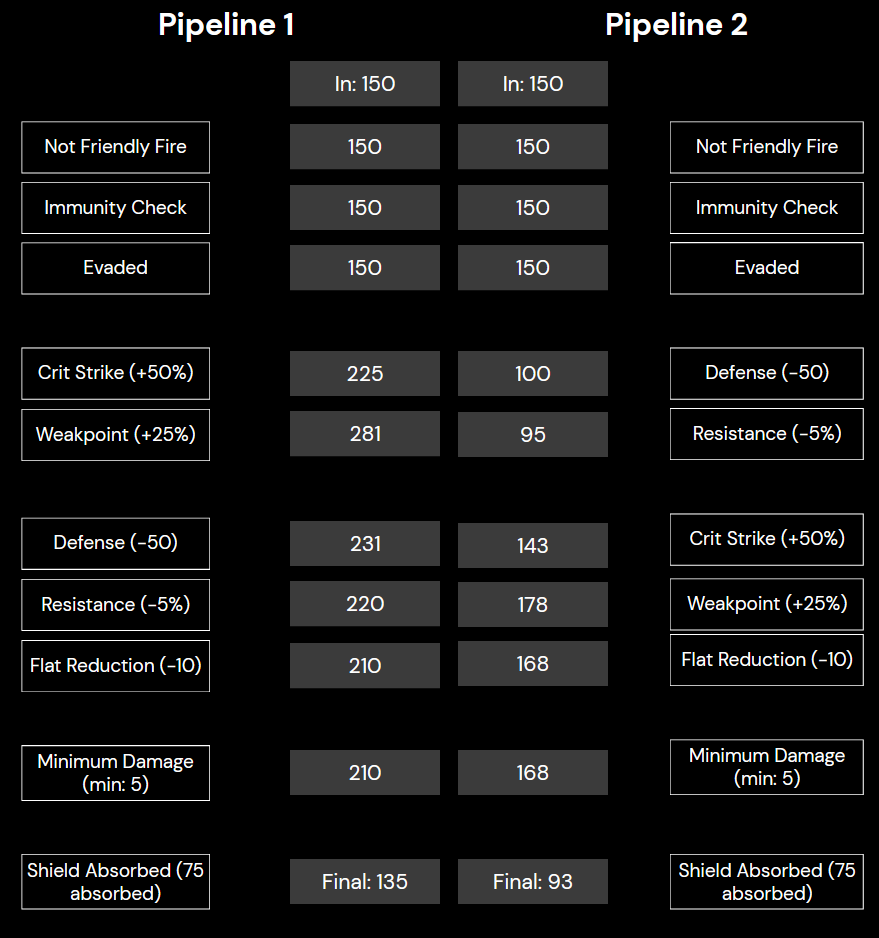
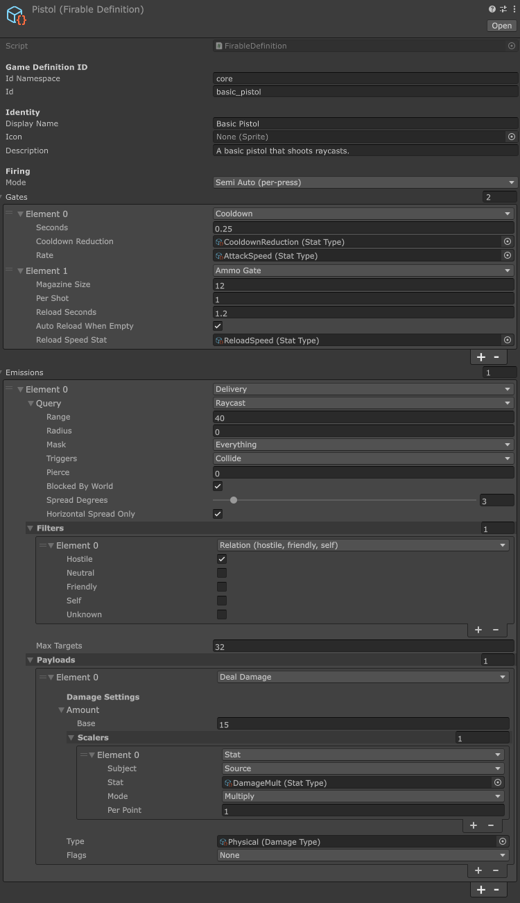
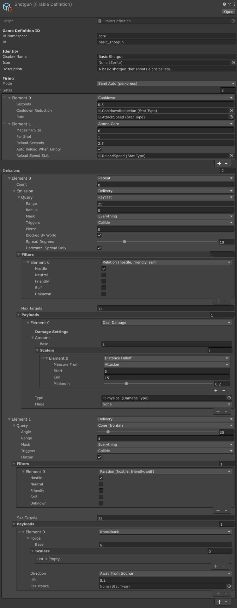
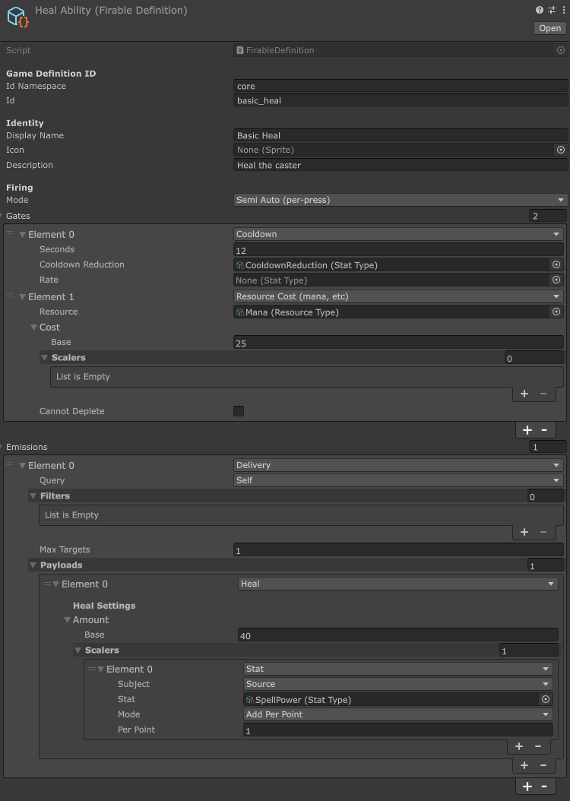
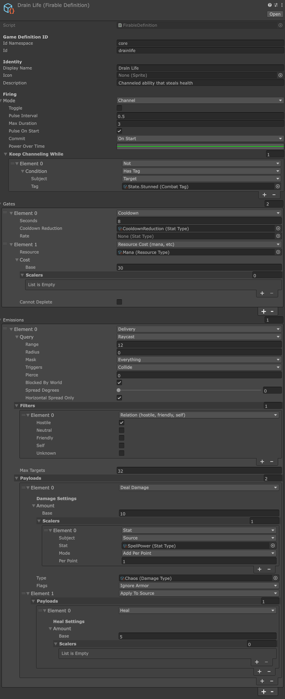
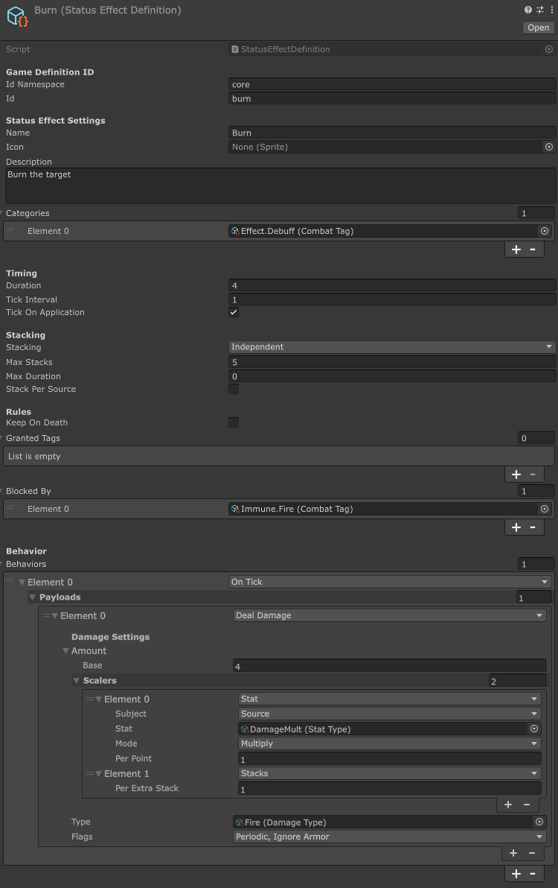
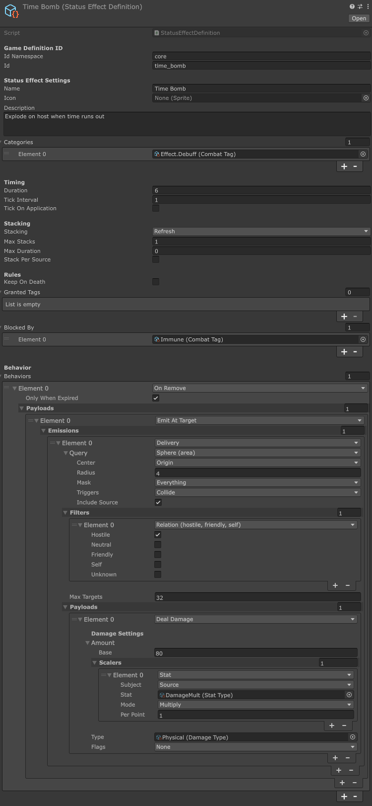

# CG Combat Framework

**A data driven composable combat framework for Unity.**

Build weapons, abilities, and status effects in the inspector.


## Highlights

- **Everything is built in the inspector.** Build anything with a variety of combinations to suit whatever you need.
- **Many built-in building blocks.** 18 payloads, 7 query types, 13 conditions, 9 value scalers, 10 damage steps, 5 firing modes, 5 resource regen rules, multiple status effects and triggers.
- **Easy to add custom types.** Implement one interface and add a single attribute to be able to choose your custom types in the inspector.
- **Zero garbage on hot paths.** Per frame, enforced by allocation tests that fail the test run.
- **Many automated tests.** EditMode tests, PlayMode tests, and performance suites.
- **Headless design.** Combat runs without any visuals, works on servers and in tests.

## Contents

- [Overview](#overview)
- [Installation](#installation)
- [Core Concepts](#core-concepts)
    - [Units and UnitComponents](#units-and-unitcomponents)
    - [Definitions and Runtime State](#definitions-and-runtime-state)
    - [Building Blocks](#building-blocks)
    - [Damage Pipeline](#damage-pipeline)
    - [Status Effects and Triggers](#status-effects-and-triggers)
    - [Events and Services](#events-and-services)
- [Building in the Inspector](#building-in-the-inspector)
    - [Weapon Examples](#weapons)
    - [Ability Examples](#abilities)
    - [Status Effect Examples](#status-effects)
- [Editor Tools](#editor-tools)
- [Custom Implementations](#custom-implementations)
    - [Custom Payload](#custom-payload-granting-gold)
    - [Custom Damage Step](#custom-damage-step-backstab)
    - [Custom Trigger](#custom-trigger-ondash)
    - [More Extension Points](#other-extension-points)
- [Customizing the Editor](#customizing-the-editor)
    - [Custom Unit Parts](#custom-unit-parts)
    - [Database Categories](#database-categories)
    - [Block Looks](#block-looks)
    - [Colors and Icons](#colors-and-icons)
- [Integrating Yourself](#integrating-yourself)
    - [UI Views](#ui-without-inspector-references)
    - [Global Listeners](#global-listeners)
    - [Spawning and Despawning](#spawning-and-despawning)
    - [Input and AI](#input-and-ai)
    - [Sounds, Animation, VFX](#sounds-animation-vfx)
- [Design Decisions](#design-decisions)
- [Performance](#performance)
- [Testing](#testing)
- [Roadmap](#roadmap)
- [Known Limitations](#known-limitations)

## Overview

CG Combat Framework is the rules for the combat in your game. Who can be hit, how much damage to do, what reacts to what. This is meant to be usable in a variety of games, and is not built for any one type.

This is built to _not_ include movement, animations, UI, audio or netcode. This allows users to be able to hook into any system using built-in seams, states, events, and interfaces.

## Installation

1. Open **Window -> Package Manager**.
2. Click **+ -> Install package from git URL**.
3. Paste the URL of the desired version like:

```text
https://github.com/Contradictive-Games/CGCombatFramework.git#v0.3.1
```

Replace the tag at the end with the latest version from the [Releases page](https://github.com/Contradictive-Games/CGCombatFramework/releases).

**Requirements:**

- Unity 6000.0+
- Unity physics module

---

## Core Concepts

General vocabulary, what things are, etc.

### Units and UnitComponents

A **unit** is any GameObject with a `Unit` component. I.e: players, barrel, boss, turrets, invisible fire zone, etc. What a **unit** can do comes from their **components**. UnitComponents include: stats, resources (like health, mana), status effects, loadouts, etc. A barrel could be a unit with a `HealthComponent` and nothing else.

Components can be acquired like:

```csharp
if(unit.TryGet<IHealth>(out var health) && !health.IsDead)
{
    health.Kill(default);
}
```

> _These are not required to be an IUnitComponent_

Units are pooled. Each unit life gets a new `UnitId` and a `UnitHandle`. A `UnitHandle` refers to one life, so that references held across a despawn do not hit recycled Units on new lives.
Unit lifecycle looks like:

> Spawn &rarr; Arrival &rarr; (_game loop_) &rarr; Despawn &rarr; Departure &rarr; Release

### Definitions and Runtime State

Everything a designer could make is a **definition**. This is a `ScriptableObject` that is shared and never changes at runtime. Per-owner state is created into small runtime objects (like cooldown timers, magazines, stacks). Two Units can hold the same exact item, with their own independent state.
Designers can add 'presentation' data objects and get them through `TryGetData<T>()` on any `GameDefinition`.

### Building Blocks

Most of a definition is made of strategies picked from dropdowns in the inspector. Each kind answers a question

| Strategy   | Explanation                                  | Examples                                                                                                                              |
| ---------- | -------------------------------------------- | ------------------------------------------------------------------------------------------------------------------------------------- |
| Fire Mode  | How a `Firable` converts a press into firing | Semi auto, burst firing, channeled spell casts, Charged spell casts                                                                   |
| Gate       | If it can fire and what will it cost         | Cooldowns (spell cooldowns, fire rates), ammo counts, resource costs (mana cost), charges, conditions                                 |
| Emission   | What will come out                           | A projectile, random, delayed                                                                                                         |
| Query      | Who will be hit                              | Frontal cones, raycasts, area of effects, wide box slashes, everyone, chain lightning                                                 |
| Conditions | What must pass to do X                       | Has tags (immune tag, poison tag), hit zones (headshots, weak points), Resource threshold (under x% health)                           |
| Payloads   | What is going to happen to whoever is hit    | Deal damage, heal, apply status effects, knockback, consume stacks                                                                    |
| Scaler     | How big the final number is                  | Stat scalers (crit damage), power (charged attacks being higher at higher charge %), distance falloff (weaker near edge of explosion) |

Every gate is checked before anything is 'paid'. So an empty magazine can never waste a cooldown.

### Damage Pipeline

Each unit's health runs incoming damage through an ordered list of steps defined on the defender. Steps can be changed/removed freely in the inspector. Steps can also have custom implementations.

> **Important**: order matters in this. Will start from list beginning -> end



### Status Effects and Triggers

A status effect is a timed bundle of effects. Effects are very powerful and can perform a lot of different things. Adding tags, stat modifiers, payloads. This can handle different use cases like class passive effects, elite affixes, burns, stuns, item bonuses, buffs, debuffs, HoTs, etc. Effects are stackable through refresh, adding duration, and independent stacks. Effects can stack per caster and are pooled.

**Triggers** are behaviors that listen to host's event bus (the unit 'hosting' the effect) while the effect is active.

**A While Trigger** keeps another effect applied while a specific set of conditions hold

### Events and Services

Every unit comes equipped with an individual event bus. There is additionally one global event bus. Events are readonly structs that implement `ICombatEvent`, passed by reference to prevent any allocations. `GameEvents.Raise(unit, evt)` sends an event to the unit's bus and the global bus; `GameEvents.RaiseGlobal(evt)` is for events with no unit, like `PauseChangedEvent`.

Every event's first field is `Unit`, the unit whose bus it was raised on. The other unit involved is `Source` (who caused it) or `Target` (who it was done to), so a `DamageReceivedEvent` has `Unit` (the victim) and `Source` (the attacker), and the matching `DamageDealtEvent` has `Unit` (the attacker) and `Target` (the victim). Firable events carry the runtime `Firable` (its asset is `Firable.Definition`), and status effect events carry the `StatusEffectInstance`. Those instances are pooled, so read what you need inside the handler instead of keeping them.

Handlers run in the order they subscribed. A handler that throws is logged once as an `EventHandlerException` and the others still run, so a broken view can't stop a hit from landing. In the editor and development builds, a unit warns when it despawns with more handlers on its bus than at its last despawn, which is how a subscription that's never removed shows up on pooled units. Subscribing or unsubscribing during a raise takes effect from the next raise. Keep your handler in a field (`handler ??= OnDamaged`), so subscribing doesn't allocate and unsubscribing finds the same handler.

Code that has to react in a fixed order uses listener interfaces instead of the bus, registered in `Bind` and removed in `Unbind`:

- `IHealthListener` (`IHealth.AddListener`) runs right after `DiedEvent` and `RevivedEvent`. Status effects clear on death this way, after On Died triggers have run.
- `IResourceListener` (`IReadonlyResource.AddListener`) runs after a resource's changed and depleted events.
- `IStatListener` (`IReadonlyStat.AddListener`) runs before `StatChangedEvent`, so a resource's max is already rescaled when the event fires.

`CombatServices` holds all swappable services like the CombatTicker, random source (seeded or not), unit spawners, events, combat clock, pause/unpause, and unit registries.

## Building in the Inspector

Here are a few examples of weapons, abilities, and effects built entirely in the inspector using only what comes with the package.

### Weapons

<table>
  <tr>
    <td width="50%" valign="top">
      
    </td>
    <td width="50%" valign="top">
      
    </td>
  </tr>
  <tr>
    <td align="center"><b>Pistol</b></td>
    <td align="center"><b>Shotgun</b></td>
  </tr>
</table>

### Abilities

<table>
  <tr>
    <td width="50%" valign="top">
      
    </td>
    <td width="50%" valign="top">
      
    </td>
  </tr>
  <tr>
    <td align="center"><b>Heal</b></td>
    <td align="center"><b>Drain Life</b></td>
  </tr>
</table>

### Status Effects

<table>
  <tr>
    <td width="50%" valign="top">
      
    </td>
    <td width="50%" valign="top">
      
    </td>
  </tr>
  <tr>
    <td align="center"><b>Burn</b></td>
    <td align="center"><b>Time Bomb</b></td>
  </tr>
</table>

## Editor Tools

Everything lives under `Tools/CG Combat Framework`, and every window has a `Tools` menu to jump to the others. Each window has a `View` menu for what it shows and how (cozy or compact lists, Display Name / ID / File Name labels, icons, summaries and more). Choices are saved per user.

| Tool          | What it does                                                                                                                                                                                                                                                                                                                                                                                                                                                                                                                                                                                              |
| --------------- | --------------------------------------------------------------------------------------------------------------------------------------------------------------------------------------------------------------------------------------------------------------------------------------------------------------------------------------------------------------------------------------------------------------------------------------------------------------------------------------------------------------------------------------------------------------------------------------------------------- |
| Combat Studio   | One window with tabs for units, firables, status effects and damage pipelines. Firables, effects and pipelines are edited as an outline and detail view, with templates, search by building block, drag to reorder, copy and paste blocks, and keyboard shortcuts. Double clicking one of these assets opens it here. The Units tab is an overview of every unit prefab with problem checks and one click fixes, plus a wizard that makes a unit prefab from an archetype (Player, Enemy, Boss, Destructible, Summon, Training Dummy or Blank). Missing stat, resource and slot types are created for you |
| Pipeline Tester | Runs a hit through a damage pipeline between two sandbox units and shows each step's numbers. Turn steps off, drag them into a new order, see the spread over many random hits, and try every order of the steps to see how much order matters                                                                                                                                                                                                                                                                                                                                                            |
| Database        | Every definition, pipeline and unit in the project, in collapsible category sections, as a grid or a sortable list with column toggles. It has a Name / ID / File toggle, duplicate ID warnings and a details panel                                                                                                                                                                                                                                                                                                                                                                                                                                                  |
| Combat Doctor   | Easily find and fix issues with assets using the package                                                                                                                                                                                                                                                                                                                                                                                                                                                                                                                                                  |
| Usage Finder    | Find any blocks being used by asset/script reference, or by block type and easily search and find any unused assets                                                                                                                                                                                                                                                                                                                                                                                                                                                                                       |
| Firable Lab     | Edit, modify, and view stats of any `Firable`                                                                                                                                                                                                                                                                                                                                                                                                                                                                                                                                                             |
| Effect Timeline | Edit, modify, and view stats of any `StatusEffect`                                                                                                                                                                                                                                                                                                                                                                                                                                                                                                                                                        |
| Combat Monitor  | View realtime events and actions in Play Mode. Additionally hurt, heal, test any effect, or add Tags to any Unit that is active in the world                                                                                                                                                                                                                                                                                                                                                                                                                                                              |
| Faction Matrix  | View a Matrix of all Faction assets, easily edit faction relations                                                                                                                                                                                                                                                                                                                                                                                                                                                                                                                                        |
| Tag Tree        | Look at tags and their parents within a hierarchical view                                                                                                                                                                                                                                                                                                                                                                                                                                                                                                                                                 |
| Range Gizmos    | See a preview of any Firable's `Query`, whether its a raycast, sphere, cone, etc                                                                                                                                                                                                                                                                                                                                                                                                                                                                                                                          |
| Unit Inspectors | See realtime stats and information on any Unit's components                                                                                                                                                                                                                                                                                                                                                                                                                                                                                                                                               |

## Custom Implementations

Every dropdown in the package lists every class that implements its interface, in any assembly including your own. All you have to do is implement the interface, mark the class as `Serializable` and add a `TypeMenu({context_menu_path_goes_here})` attribute. Optionally add a `BlockInfo` attribute to explain what it does; the Combat Studio shows it when the block is selected, and inspectors show it as a tooltip. It can also give the block its own color and icon (see [Block Looks](#block-looks)).

### Custom Payload (granting gold)

The `IPayload` interface looks like:

```csharp
public interface IPayload { public void Apply(in EffectContext ctx); }
```

```csharp
using CG.CombatFramework;
using UnityEngine;

[System.Serializable, TypeMenu("Economy/Grant Gold")]
[BlockInfo("Gives gold to the subject's wallet.", Example = "Owner: 5 gold per kill, credited to the player for their turret's kills")]
public sealed class GrantGoldPayload : IPayload
{
    [SerializeField, Tooltip("Owner = the source's top owner, so summons and turrets pay the player")] private Subject subject = Subject.Owner;
    [SerializeField] private ScalableValue amount = new(5f);

    public void Apply(in EffectContext ctx)
    {
        var unit = ctx.GetUnit(subject);
        if(unit == null || !unit.TryGet<Wallet>(out var wallet)) return;
        wallet.Add(Mathf.RoundToInt(amount.Evaluate(in ctx)));
    }
}

```

Select this payload in an OnKill trigger of an item. `Wallet` = your component.

### Custom Damage Step (backstab)

Add your own custom damage step into the DamagePipeline in your inspector.

The `IDamageStep` interface looks like:

```csharp
public interface IDamageStep { public void Process(ref DamageCalculation calc); }
```

> **NOTE:** The order is IMPORTANT. This computes the damage it has already calculated up to this step. If you want a critical strike to be taken into consideration after a damage increase from the backstab step, you would put the backstab step before the crit strike step.

```csharp
using CG.CombatFramework;
using UnityEngine;

[System.Serializable, TypeMenu("Attacker/Backstab")]
[BlockInfo("Multiplies damage when the attacker stands behind the target.", Example = "x2 within 60° of the target's back")]
public sealed class BackstabStep : IDamageStep
{
    [SerializeField, Min(1f)] private float multiplier = 2f;
    [SerializeField, Range(0f, 180f), Tooltip("Width of the cone behind the target")] private float behindAngle = 60f;

    public void Process(ref DamageCalculation calc)
    {
        var attacker = calc.Request.Context.SourceUnit;
        if(attacker == null || calc.TargetUnit == null) return;

        var target = calc.TargetUnit.Transform;
        var fromTarget = attacker.Transform.position - target.position;
        fromTarget.y = 0f;
        if(Vector3.Angle(-target.forward, fromTarget) <= behindAngle * 0.5f) calc.Amount *= multiplier;
    }
}

```

### Custom Trigger (OnDash)

Your own custom game events will ride the same event buses. Make it a `readonly struct` that implements `ICombatEvent`, raise it, and a `Trigger` can react just as it does with a built-in event.

```csharp
public readonly struct DashedEvent : ICombatEvent 
{
    public readonly IUnit Unit;
    public readonly Vector3 From;
    public readonly Vector3 To;

    public DashedEvent(IUnit unit, Vector3 from, Vector3 to)
    {
        Unit = unit;
        From = from;
        To = to;
    }
}

// ...somewhere in your movement code you raise:
GameEvents.Raise(unit, new DashedEvent(unit, start, transform.position));


[Serializable, TypeMenu("Triggers/On Dash")]
[BlockInfo("Runs payloads when the host dashes. Other is the host, Amount is the dash distance.", Example = "Afterimage: gain 10% move speed for 2s after each dash")]
public sealed class OnDashTrigger : TriggerBehavior<DashedEvent> 
{
    [SerializeField, Min(0f)] private float minimumDistance;

    protected override bool Read(in DashedEvent evt, StatusEffectInstance effect, out TriggerRead read)
    {
        float distance = Vector3.Distance(evt.From, evt.To);
        read = new TriggerRead(effect.Host, default, distance, 0);
        return distance >= minimumDistance;
    }
}
```

The `Amount` reaches a `TriggeredAmount` scaler, so a payload could scale with the dash distance.

### Other Extension Points

| Interface               | Write when you want                                   |
| ----------------------- | ----------------------------------------------------- |
| `IFireMode`             | A new firing type                                     |
| `IFireGate`             | A new cost for firing                                 |
| `IHitQuery`             | A new shape to check for enemies                      |
| `ICondition`            | Any yes/no check                                      |
| `IValueScaler`          | Any number transformation                             |
| `IStatusEffectBehavior` | Anything that an effect can do over its lifetime      |
| `IRegenRule`            | How a resource will refill (or decay)                 |
| `IUnitComponent`        | A new unit component with spawn/despawn/binding hooks |
| `IEmission`             | A new behavior when a firable successfully fires      |
| `IDamageStep`           | A new calculation to be done on damage                |
| `IArrivalSequence`/`IDepartureSequence` | A sequence to happen when a unit arrives/leaves |
| `IUnitView`             | A component that binds to a Unit (and likely displays info) |
| `IDefinitionData`       | Visuals, sounds, or more data on a `GameDefinition`   |
| `ICombatEvent`          | A new event type to invoke/listen to on the `EventBus` |

## Customizing the Editor

Your own types can tell the editor windows how to name, group and draw them, with three attributes.

| Attribute          | Put it on                                     | Sets                                                                   |
| ------------------ | --------------------------------------------- | ---------------------------------------------------------------------- |
| `[UnitPart]`       | A `MonoBehaviour` that belongs on a unit      | `Label`, `Description`, `Group`, `Color`, `Icon`, `Order`, `Hidden`    |
| `[DefinitionInfo]` | A `GameDefinition` type                       | `Title`, `Group`, `Description`, `Color`, `Icon`, `Order`              |
| `[BlockInfo]`      | A building block, `IDefinitionData` included  | `Description`, `Example`, `Color`, `Icon`                              |

The built-in parts and definitions use the same attributes. `Group`, `Color` and `Icon` come from a base class when a type doesn't set them, so one base class can color every sub type.

### Custom Unit Parts

Every `MonoBehaviour` that implements `IUnitComponent` is a custom part. It shows in a Custom Parts section under the built-in parts in the Combat Studio's unit overview, the Unit inspector and the unit wizard, where it can be added and removed like the built-in ones. `[UnitPart]` names and groups it and also turns a behaviour that isn't an `IUnitComponent` into a part.

```csharp
[UnitPart("Turret Brain", Description = "Fires at the nearest hostile", Group = "AI", Color = "#F78166", Icon = "query")]
[RequireComponent(typeof(FirableLoadout), typeof(TransformAimProvider))]
public sealed class TurretBrain : MonoBehaviour, IUnitComponent, ITickable
{
    private IUnit owner;

    void IUnitComponent.Initialize(IUnit owner) => this.owner = owner;
    public void Tick(float deltaTime) { }
}
```

- A part needs whatever `[RequireComponent]` lists, and the required one will be removed/added when the other is.
- Without a label, a part uses the last segment of `[AddComponentMenu]`, then type name.
- Parts sort by `Order` within their group (lower first), then by label. Built-in parts use -100 to -10.
- `[UnitPart(Hidden = true)]` or `[AddComponentMenu("")]` leaves a type out.
- Unit components only run on the unit's root, so the unit checks warn about one on a child object.

### Database Categories

Every `GameDefinition` type gets a category in the Database. `[DefinitionInfo]` names it, describes it and puts it in a section.

```csharp
[DefinitionInfo("Characters", Group = "Lore", Description = "People in the story", Color = "#C792EA", Icon = "Assets/Lore/Icons/Person.svg")]
[CreateAssetMenu(menuName = "Lore/Character")]
public sealed class LoreCharacter : GameDefinition
{
    [SerializeField, TextArea] private string description;
    public Sprite Icon;
}
```

- `Group` makes a collapsible section on the Categories pane. Nest sections with `/`, as in `"Lore/People"`. Built-in types sit in Combat, and types with no group in Other. View › Group Categories on that pane switches to one flat list.
- Without a title, the category is the type name without "Definition", made plural: `QuestDefinition` becomes Quests.
- `Description` is the category's tooltip, and shows in an empty category.
- Categories sort by `Order` within a section and in the flat list, then by title. Built-in types use -120 to -10, so yours follow them unless you set it.
- A string field named `Description` (public or `[SerializeField]`) shows under the asset's name in the Database and Combat Studio details.
- A public `Sprite` field (one named `Icon` first) is the asset's tile image, and a public `Color` field tints its tile. Without them, the tile uses the type's look.

The Combat Doctor and Usage Finder use the type's look too.

### Block Looks

`[BlockInfo]` takes a `Color` and `Icon` as well. Leave out the description to set only a look: `[BlockInfo(Color = "teal")]`.

```csharp
[Serializable, TypeMenu("Lore/Voice Lines")]
[BlockInfo("Lines this definition can say", Color = "#C792EA", Icon = "path:M4 4h16v12H8l-4 4z")]
public sealed class VoiceLines : IDefinitionData
{
    [SerializeField] private AudioClip[] clips;
}
```

The look shows on block headers in inspectors, the Combat Studio, on Studio outline rows, and in block pickers, which also show the highlighted block's description and example. A block with no look of its own uses its category's color and icon. `IDefinitionData` blocks have their own Data color.

### Colors and Icons

A color is `#RGB`, `#RRGGBB`, `#RRGGBBAA`, or a color name Unity knows, like `orange`, `teal` or `purple`.

An icon is one string, tried in this order:

| Form                      | Example                         | Draws                                                                                     |
| ------------------------- | ------------------------------- | ----------------------------------------------------------------------------------------- |
| `path:` + SVG path data   | `"path:M4 4h16v12H8l-4 4z"`     | A filled shape in the type's color                                                        |
| `stroke:` + SVG path data | `"stroke:M5 12h14M12 5v14"`     | An outlined shape in the type's color                                                     |
| A built-in glyph name     | `"faction"`                     | That glyph in the type's color                                                            |
| An asset path             | `"Assets/Lore/Icons/Book.svg"`  | The asset in its own colors: an SVG imported as a UI Toolkit Vector Image, a sprite or a texture |
| A Unity editor icon name  | `"TextAsset Icon"`              | Unity's own icon                                                                          |

The glyph names are `payload`, `emission`, `query`, `condition`, `scaler`, `gate`, `firemode`, `damagestep`, `regen`, `behavior`, `trigger`, `unit`, `tag`, `faction`, `stat`, `resource`, `damage`, `pipeline`, `slot`, `profile`, `modifier`, `test`, `data` and `other`.

A string that matches none of these, or path data that doesn't parse, falls back to the default icon with a console warning.

**Getting SVG path data:** open the `.svg` in a text editor and copy the `d="..."` from its `<path>`. If it has several paths, join their `d` values with a space.

**Using an `.svg` file:** in its import settings, choose UI Toolkit Vector Image. Importing SVGs needs Unity's Vector Graphics module (`com.unity.modules.vectorgraphics`, under Built-in in the Package Manager).

---

## Integrating Yourself

### UI Without Inspector References

Views implement `IUnitView` and never search for a unit, something binds a unit to them. Unit views unbind when the unit is **released**, after the unit departs, **not** when it despawns. Use the following example of a view for a Healthbar:

```csharp
public sealed class HealthBarView : MonoBehaviour, IUnitView 
{
    [SerializeField] private Image fill;

    private IUnit unit;
    private IHealth health;
    private GameEventHandler<ResourceChangedEvent> changed;

    /*
        Subscribe to the event we are going to use to update our HealthBar display
        in Bind, and read the current state when we subscribe (to prevent empty
        healthbar on init)
    */
    public void Bind(IUnit unit)
    {
        if(!unit.TryGet(out health)) return;
        this.unit = unit;
        changed ??= OnChanged;
        unit.Events.Subscribe(changed);
        Show(health.Resource.Current, health.Resource.Max);
    }

    /*
        Unsubscribe in Unbind
    */
    public void Unbind()
    {
        unit?.Events.Unsubscribe(changed);
        unit = null;
        health = null;
    }

    private void OnChanged(in ResourceChangedEvent evt)
    {
        if(evt.Change.Resource != health.Resource) return;
        Show(evt.Change.New, evt.Change.Max);
    }

    private void Show(float current, float max) => fill.fillAmount = max > 0f ? current / max : 0f;
}
```

- **On a unit prefab** (like for worldspace healthbars, nameplates), add a `UnitViewBinder` to the prefab, and every view inside is bound on spawn and unbound on release
- **For units matching a rule** (like for boss HUD bars, party frames); `UnitWatcher` reports every matching unit already spawned then every one spawned later.

```csharp
private UnitWatcher watcher;
private void OnEnable() => watcher = new UnitWatcher(u => u.Tags.Has(bossTag), onFound: ShowBossBar, onLost: HideBossBar);
private void OnDisable() => watcher.Dispose();
```

This filter is checked on spawn. A unit that may gain the tag later needs to do `watcher.Refresh(unit)`.


### Global Listeners

For anything that isn't specific to a singular unit, and is used globally (like display damage numbers) we can use the global EventBus on `CombatServices`.

```csharp
public sealed class DamageNumberDisplay : MonoBehaviour 
{
    private GameEventHandler<DamageReceivedEvent> received;

    private void OnEnable()
    {
        received ??= OnReceived;
        CombatServices.Events.Subscribe(received);
    }

    private void OnDisable() => CombatServices.Events.Unsubscribe(received);

    private void OnReceived(in DamageReceivedEvent evt)
    {
        var result = evt.Result;
        if(result.Dealt <= 0f) return;
        Show(result.Request.Context.Hit.Point, result.Dealt, result.IsCrit);
    }

    private void Show(Vector3 pos, float amount, bool isCrit) { /* show the damage numbers */ }
}
```

### Spawning and Despawning

When spawning any units, ensure we going through the spawner so that units are pooled and always get a fresh `UnitId`. If you have units placed within a scene, tick `SpawnOnStart` on the unit, and optionally tick `ArriveOnStart` if you want an arrival sequence when Start is called.

`DespawnOnDeath` will remove corpses after a delay, and a revive can cancel it.

Despawning a unit with `DespawnReason.SessionEnd` and `DespawnReason.Unloaded` skip departures.

```csharp
[SerializeField] private Unit gruntPrefab;
[SerializeField] private CombatTag[] dropIn;

var grunt = CombatServices.Spawner.Spawn(gruntPrefab, new SpawnData(point, Quaternion.identity, arrivalTags: dropIn));
CombatServices.Spawner.Despawn(grunt, DespawnReason.Recycled);
CombatServices.EndSession();
```

#### Arrival Sequence

If you want a unit to do something specific on arrival (like a boss intro animation, enemies crawling up from the ground, enemies coming in from a drop pod), make a custom arrival sequence.

```csharp
/*
    An example arrival sequence that scales the model's transform from 0 -> 1 over the duration
*/
public sealed class ScaleInArrival : MonoBehaviour, IArrivalSequence 
{
    [SerializeField] private Transform model;
    [SerializeField, Min(0.01f)] private float duration = 0.4f;
    
    private float remainingTime;

    public float Begin(IUnit unit, IReadOnlyList<CombatTag> tags)
    {
        remainingTime = duration;
        model.localScale = Vector3.zero;
        return duration;
    }

    public void Stop()
    {
        remainingTime = 0f;
        model.localScale = Vector3.one;
    }

    private void Update()
    {
        if(remainingTime <= 0f || CombatServices.IsPaused) return;
        remainingTime -= Time.deltaTime;
        model.localScale = Vector3.one * (1f - Mathf.Clamp01(remainingTime / duration));
    }
}
```

If you return 0 in `Begin` it will skip (like if tags don't match). Units will hold the arrival tags until its longest arrival sequence is finished. Pairing arrival tags with something like an `Immune` tag and an `ImmuneWithTag` step in the DamagePipeline would effectively give spawn protection.
`IDepartureSequence` works the same with a `DespawnReason`. 

Sequences show in the Combat Studio and the unit wizard as parts, under a Sequences heading. See [Custom Unit Parts](#custom-unit-parts).

### Input and AI

PlayerInput and AI functions will use the same calls

```csharp
loadout.Press(primary);
loadout.Release(primary);
loadout.Reload(primary);

// player: GroundPlaneAimProvider
groundAim.SetScreenPoint(Mouse.current.position.ReadValue());

//AI: TransformAimProvider
transformAim.SetTarget(enemy);
```

A unit only ticks components that are also an `IUnitComponent` and sit on the unit's root GameObject, or were added with `AddUnitComponent`. Here's an example of an AI TurretBrain that would successfully tick

```csharp
public sealed class TurretBrain : MonoBehaviour, IUnitComponent, ITickable
{
    [SerializeField] private FirableSlot weapon;
    private FirableLoadout loadout;
    private TransformAimProvider aim;

    public void Initialize(IUnit owner)
    {
        owner.TryGet(out loadout);
        owner.TryGet(out aim);
    }

    public void Tick(float deltaTime)
    {
        //Find target, release if no target
        //Aim at target if there is, shoot if within range
    }
}
```

### Sounds, Animation, VFX

- **Unit reactions.** Use an `IUnitView` listening to `DamageReceivedEvent`, `DiedEvent`, `FiredEvent`, `FiringPhaseChangedEvent`, etc to do things like a hitflash, death animation, muzzle flash/particles, firing/not firing
- **Per asset visuals.** Use `IDefinitionData` and create options for StatusEffectVisuals (for particles like poison clouds, bleeding), WeaponVisuals (for weapon model, sounds, muzzle flash, reloading sounds, etc)

```csharp
[System.Serializable, TypeMenu("Presentation/Firable Sounds")]
[BlockInfo("Sounds for this firable", Example = "Rifle: Rifle shot")]
public sealed class FirableSounds : IDefinitionData
{
    public AudioClip FireSound;
}

//... somewhere in your code
private void OnFired(in FiredEvent evt)
{
    //Generally good to cache, instead of getting this every single time its fired
    if(evt.Firable.Definition.TryGetData(out FirableSounds sounds) && sounds.FireSound != null) audioSource.PlayOneShot(sounds.FireSound);
}
```

Adding `System.Serializable`, `TypeMenu` and `BlockInfo` attributes are all a great way to fit your custom integrations easily into the custom editor windows!

---

## Design Decisions

**Composition > inheritance**. There is no single monolith Unit component that handles all sorts of things (health, weapons, status effects). Units are instead built through adding multiple components/capabilities. Every component lookup goes through a `TryGet<T>`, a per-type slot index in a cached array.

**Strategy Pattern**. Using `[SerializeReference]` allows for the strategy pattern to be extremely useful for designing everything in the inspector. Add your own custom Conditions, Payloads, Queries, etc and all you have to do is select that option in the dropdown of the item's ScriptableObject.

**Handles for pooled objects**. `UnitHandle` and the versioned `StatusEffectHandle` know when a target's life has ended, so a reference held across a despawn can't hit whoever reuses that pooled object. This does require an extra ID check on every resolve, but is otherwise very useful to use.

**Struct events passed by `in`.** No boxing/garbage when raising events with a per-unit bus or global bus.

**One tick source.** Combat time comes from a swappable `ITickSource`. That single hook gives the ability for combat-only pauses, fixed-step ticking, delayed effects that pause correctly, and deterministic tests. `CombatServices.Time` is the combat clock in seconds. It moves to whichever tick source is assigned and advances once per tick, so a tickable that runs before it in the same tick reads the previous value.

**Measured with performance tests.** An allocation test found a real problem with a hot path that was using a `List.Sort` with a comparer in area queries. Adding performance tests allows me to ensure better performance/design standards.

---

## Performance

All per-frame hot paths are covered by allocation tests that fail if they do allocate. This includes ticking, firing, damage pipeline, area queries, projectile flights.

Units, projectiles, and status effects, hit collections are all pooled.

Each system has a profiler marker (`CG.Combat.*`).

| Benchmark                                           | Median | Per             |
| --------------------------------------------------- | ------ | --------------- |
| Damage request through all 10 damage pipeline steps | 363ns  | hit             |
| Status effects, 1k units x 3 effects                | 0.37ms | frame           |
| Sphere delivery among 200 units (~20 hits)          | 18µs   | delivery        |
| 100 projectiles in flight                           | 0.24ms | simulation step |
| 200 burning units, combat tick                      | 26µs   | frame           |

---

## Testing

| Suite       | Tests | Covers                                                                                                          |
| ----------- | ----- | --------------------------------------------------------------------------------------------------------------- |
| EditMode    | ~396  | Stats, resources, regen, firables, gates, damage pipeline, status effects, triggers, value scalers, allocations |
| PlayMode    | ~82   | Spawning, pooling, handles, real physics queries, projectiles, combat flows                                     |
| Performance | ~24   | Benchmarks per system and whole frames                                                                          |

## Roadmap

**Next**

- [ ] Netcode hooks (server-auth damage with replicated health/effects)
- [ ] Package Samples
    - [ ] Presentation examples (UI, VFX, sounds, models, etc)
    - [ ] Extending the package (more commonly used built-in blocks)
    - [ ] Combat sandbox simulation (to show all systems interacting)
- [ ] Better homing projectile targeting
- [x] Editor tooling
    - [x] Firable preview
    - [x] Damage pipeline debugger (Pipeline Tester)

## Known Limitations

- Single-threaded
- Homing projectiles find targets by scanning unit registry; large counts may cause performance spikes
