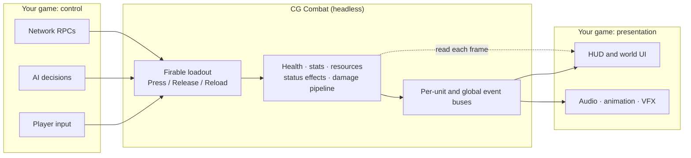
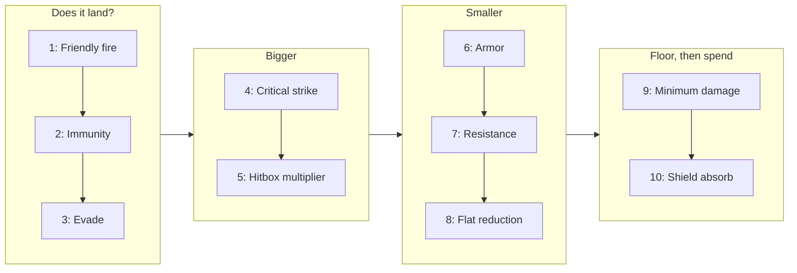

# CG Combat Framework

**A data driven composable combat framework for Unity.**

Build weapons, abilities, and status effects in the inspector.


## Highlights

- **Everything is built in the inspector.** Build anything with a variety of combinations to suit whatever you need.
- **Many built-in building blocks.** 22 payloads, 9 query types, 13 conditions, 9 value scalers, 10 damage steps, 5 firing modes, 5 resource regen rules, multiple status effects and triggers.
- **Easy to add custom types.** Implement one interface and add a single attribute to be able to choose your custom types in the inspector.
- **Zero garbage on the hot paths.** Per frame, enforced by allocation tests that fail builds.
- **Many automated tests.** EditMode tests, PlayMode tests, and performance suites.
- **Headless by design.**

## Contents

- [Overview](#overview)
- [Installation](#installation)
- [Core Concepts](#core-concepts)
    - [Units and UnitComponents](#units-and-unitcomponents)
    - [Definitions and Runtime State](#definitions-and-runtime-state)
    - [Building Blocks](#building-blocks)
    - [Damage Pipeline](#damage-pipeline)
    - [Status Effects and Triggers](#status-effects-and-triggers)
    - [Events and Services](#events-and-services)
- [Building In Inspector](#building-in-inspector)
- [Custom Implementations](#custom-implementations)
    - [Custom Payload](#custom-payload-granting-gold)
    - [Custom Damage Step](#custom-damage-step-backstab)
    - [Custom Trigger](#custom-trigger-ondash)
    - [More Extension Points](#other-extension-points)
- [Integrating Yourself](#integrating-yourself)
- [Design Decisions](#design-decisions)
- [Performance](#performance)
- [Testing](#testing)
- [Roadmap](#roadmap)
- [Known Limitations](#known-limitations)

---

## Overview

CG Combat Framework is the rules for the combat in your game. Who can be hit, how much damage to do, what reacts to what. This is meant to be usable in a variety of games, and is not built for any one type.

This is built to *not* include movement, animations, UI, audio or netcode. This allows users to be able to hook into any system using built-in seams, states, events, and interfaces.



---

## Installation

**Requirements** Unity 6000.0+. Unity physics module.

1. Open **Window -> Package Manager**.
2. Click **+ -> Install package from git URL**.
3. Paste the URL of the desired version like:

```text
https://github.com/Contradictive-Games/RGS-CGCombatFramework#v0.1.0
```

To try any samples, select the package in **Package Manager** and open the **Samples** tab.

---

## Core Concepts

General vocabulary, what things are, etc.

### Units and UnitComponents

A **unit** is any GameObject with a `Unit` component. I.e: players, barrel, boss, turrets, invisible fire zone, etc. What a **unit** can do comes from their **components**. UnitComponents include: stats, resources (like health, mana), status effects, loadouts, etc. A barrel could be a unit with a `HealthComponent` and nothing else.

Components can be acquired like:
```csharp
if(unit.TryGet<T>(out var T)){ /* do whatever */ }
```
> *These are not required to be an IUnitComponent*

Units are pooled. Each unit life gets a new `UnitId` and a `UnitHandle`. A `UnitHandle` refers to one life, so that references held across a despawn do not hit recycled Units on new lives.

### Definitions and Runtime State

Everything a designed could make is a **definition**. This is a `ScriptableObject` that is shared and never changes at runtime. Per-owner state is created into small runtime objects (like cooldown timers, magazines, stacks). Two Units can hold the same exact item, with their own indpendent state.

### Building Blocks

Most of a definition is made of strategies picked from dropdowns in the inspector. Each kind answers a question

| Strategy | Explanation | Examples |
|---|---|---|
| Fire Mode | How a `Firable` converts a pres into firing | Semi auto, burst firing, channeled spell casts, Charged spell casts |
| Gate | If it can fire and what will it cost | Cooldowns (spell cooldowns, fire rates), ammo counts, resource costs (mana cost), charges, conditions |
| Emission | What will come out | A projectile, random, delayed |
| Query | Who will be hit | Frontal cones, raycasts, area of effects, wide box slashes, everyone, chain lightning |
| Conditions | What must pass to do X | Has tags (immune tag, poison tag), hit zones (headshots, weak points), Resource threshold (under x% health) |
| Payloads | What is going to happen to is hit | Deal damage, heal, apply status effects, knockback, consume stacks |
| Scaler | How big the final number is | Stat scalers (crit damage), power (charged attacks being higher at higher charge %), distance fallof (weaker near edge of explosion) |

Every gate is checked before anything is 'paid'. So an empty magazine can never waste a cooldown.

### Damage Pipeline

Each unit's health runs incoming damage through an ordered list of steps defined on the defender. Steps can be changed/removed freely in the inspector. Steps can also have custom implementations.

> **Important**: order matters in this. Will start from list beginning -> end



### Status Effects and Triggers

A status effect is a timed bundle of effects. Effects are very powerful and can perform a lot of different things. Adding tags, stat modifiers, payloads. This can handle different use cases like class passive effects, elite affixes, burns, stuns, item bonuses, buffs, debuffs, HoTs, etc. Effects are stackable through refresh, adding duration, and independent stacks. Effects can stack per caster and are pooled.

**Triggers** are behaviors that listen to host's (whoever has the effect) while the effect is active.

**A While Trigger** keeps another effect applied while a specific set of conditions hold

### Events and Services

Every unit comes equipped with an individual event bus. There is additionally one global event bus.Events are readonly structs passed by reference to prevent any allocations. 

`CombatServices` holds all swappable services like the CombatTicker, random source (seeded or not), unit spawners, and unit registries.

---

## Building In Inspector

To showcase the power of all the built-in features, the following are some examples of common use-case items/effects/abilities/weapons

**Assault Rifle**

**Bleed**


---

## Custom Implementations

Every dropdown in the package lists every class that implements its interface, in any assembly including your own. All you have to do is implement the interface, mark the class as `Serializable` and add a `TypeMenu({context_menu_path_goes_here})` attribute.

### Custom Payload (granting gold)

The `IPayload` interface looks like:

```csharp
public interface IPayload { public void Apply(in EffectContext ctx); }
```

```csharp
using CG.CombatFramework; /* use this namespace */

[System.Serializable, TypeMenu("Economy/Grant Gold")]
public sealed class GrantGoldPayload : IPayload
{
    [UnityEngine.SerializeField] private ScalableValue amount = new(5f);

    public void Apply(in EffectContext ctx){
        var source = ctx.SourceUnit?.Root(); //credits all the way to the owner (i.e: turret kills)
        if(source != null && source.TryGet<WalletComponent>(out var wallet)){
            wallet.Add(Mathf.RoundToInt(amount.Evaluate(in ctx)));
        }
    }
}
```

Select this payload in an OnKill trigger of an item. `WalletComponent` = your component.

### Custom Damage Step (backstab)

Add your own custom damage step into the DamagePipeline in your inspector. 

The `IDamageStep` interface looks like:

```csharp
    public interface IDamageStep { public void Process(ref DamageCalculation calc); }
```

> **NOTE:** The order is IMPORTANT. This computes the damage it has already calculated up to this step. If you want a critical strike to be taken into consideration after a damage increase from the backstab step, you would put the backstab step before the crit strike step.

```csharp
[System.Serializable, TypeMenu("Attacker/Backstab")]
public sealed class BackstabkStep : IDamageStep {
    [UnityEngine.SerializeField, UnityEngine.Min(1f)] 
    private float multiplier = 2f;
    [UnityEngine.SerializeField, UnityEngine.Range(0f, 180f)] 
    private float behindAngle = 60f;

    public void Process(ref DamageCalculation calc){
        var attacker = calc.Request.Context.SourceUnit;
        if(attacker == null) return;
        var target = calc.TargetUnit.Transform;
        Vector3 fromTarget = attacker.Transform.position - target.position;
        if(Vector3.Angle(-target.forward, fromTarget) <= behindAndle * 0.5f) calc.Amount *= multiplier;
    }
}
```

### Custom Trigger (OnDash)

Your own custom game events will ride the same event buses. Raise one, and a `Trigger` can react just as it does with a built-in event.

```csharp
public readonly struct YourOnDashedEvent {
    public readonly IUnit Unit;
    public DashedEvent(IUnit unit) => Unit = unit;
}

// ...somewhere in your movement code you raise:
GameEvents.Raise(unit, new YourOnDashedEvent(unit));

// You create your own trigger
[Serializable, TypeMenu("Triggers/On Dash")]
public sealed class OnDashTrigger : TriggerBehavior<DashedEvent> {
    protected override bool Read(in DashedEvent evt, StatusEffectInstance effect, out TriggerRead read){
        read = new TriggerRead(null, default, 0f, 0); // nothing needed in this
        return true;
    }
}
```

### Other Extension Points

| Interface | Write when you want |
|---|---|
| `IFireMode` | A new firing type |
| `IFireGate` | A new cost for firing |
| `IHitQuery` | A new shape to check for enemies |
| `ICondition` | Any yes/no check |
| `IValueScaler` | Any number transformation |
| `IStatusEffectBehavior` | Anything that an effect can do over its lifetime |
| `IRegenRule` | How a resource will refill (or decay)
| `IUnitComponent` | A new unit component with spawn/despawn/binding hooks |

---

## Integrating Yourself

### UI Without Inspector References

Views implement `IunitView` and never search for a unit, something binds a unit to them.

- **On a unit prefab** (like for worldspace healthbars, nameplates), add a `UnitViewBinder` to the prefab, and every view inside is bound/unbound on spawn/despawn
- **For units matching a rule** (like for boss HUD bars, party frames); `UnitWatcher` reports every matching unit already spawned then every one spawned later.

```csharp
watcher = new UnitWatcher(u => u.Tags.Has(bossTag), onFound: ShowBossBar, onLost: HideBossBar);
```

### Input and AI

PlayerInput and AI functions will use the same four functions

```csharp
loadout.Press(loadoutSlot);
loadout.Release(loadoutSlot);
loadout.Reload(loadoutSlot);
aimProvider.SetTarget(target); // or screenpoint
```

AI that implements the `ITickable` interface on the unit will be ticked by the `CombatTicker`, so it will pause when combat pauses.


### Sounds, Animation, VFX

- **Unit reacts** (like for hit flash, death animations, death sound), you can have a component on the prefab listening to the event bus on the unit.
- **Visuals of a status effect** (like flames on a burning enemy, poison cloud on poisoned enemy), you can have a behavior on the status effect attach to the prefab while it is active.
- **Weapon cosmetics** (like muzzle flash, impact sparks), you can write a custom `PlayVFXEmission` or a `PlayVFXPayload` implementing the `IEmission` or `IPayload` and add it onto the FirableDefinition in the Unity inspector.


---

## Design Decisions

**Composition > inheritance**. There is no single monolith Unit component that handles all sorts of things (health, weapons, status effects). Units are instead built through adding multiple components/capabilities. Every component lookup goes through a `TryGet<T>`, a dictionary access.

**Strategy Pattern**. Using `[SerializeReference]` allows for the strategy pattern to be extremely useful for designing everything in the inspector. Add your own custom Conditions, Payloads, Queries, etc and all you have to do is select that option in the dropdown of the item's ScriptableObject.

**Handles for pooled objects**. `UnitHandle` and the versioned `StatusEffectHandle` knows when a target's life has ended, preventing pooling from producing damaging incorrect enemies on recycled object bugs. This does require an extra ID check on every resolve, but is otherwise very useful to use.

**Struct events passed by `in`.**. No boxing/garbage when raising events with a per-unit bus or global bus.

**One tick source.** Combat times comes from a swappable `ITickSource`. That single hook gives the ability for combat-only pauses, fixed-step ticking, delayed effects that pause correctly, and determenistic tests.

**Measured with performance tests.** An allocation test found a real problem with a hot path that was using a `List.Sort` with a comparer in area queries. Adding performance tests allows me to ensure better performance/design standards.

---

## Performance

All per-frame hot paths are covered by allocation tests that fail if they do allocate. This includes ticking, firing, damage pipeline, area queries, projectile flights.

Units, projectiles, and status effects, hit collections are all pooled.

Each system has a profiler marker (`CG.Combat.*`).

| Benchmark | Median | Per |
|---|---|---|
| Damage request through all 10 damage pipeline steps | 0.41µs | hit|
| Status effects, 1k units x 3 effects | 0.37ms | frame|
| Sphere delivery among 200 units (~20 hits) | 18µs | delivery |
| 100 projectiles in flight | 0.24ms | simulation step|
| 200 burning units, combat tick | ~1ms | frame |

---

## Testing

| Suite | Tests | Covers |
|---|---|---|
| EditMode | ~110 | Stats, resources, regen, firables, gates, damage pipeline, status effects, triggers, value scalers, allocations |
| PlayMode | ~27 | Spawning, pooling, handles, real physics queries, projectiles, combat flows |
| Performance | ~14 | Benchmarks per system and whole frames | 

## Roadmap

**Next**
- [ ] More triggers (on healed, on fired, on effect applied)
- [ ] HeatFireGate w/ overheat lockout
- [ ] Netcode hooks (server-auth damage with replicated health/effects)
- [ ] Editor tooling
    - [ ] Firable preview
    - [ ] Damage pipeline debugger
- [ ] Better homing projectile targeting

## Known Limitations

- Single-threaded
- Homing projectiles find targets by scanning unit registry; large counts may cause performance spikes